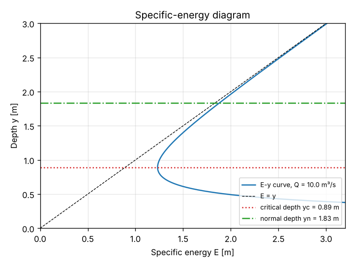
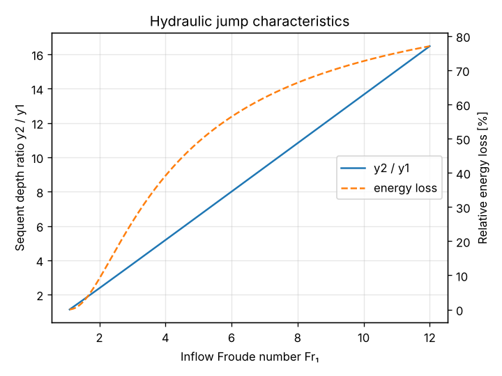
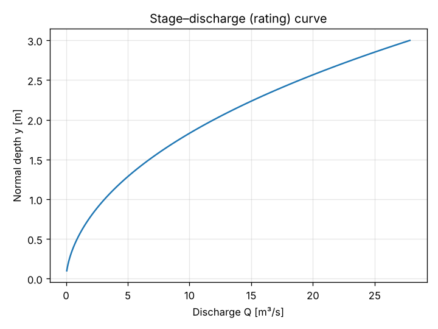
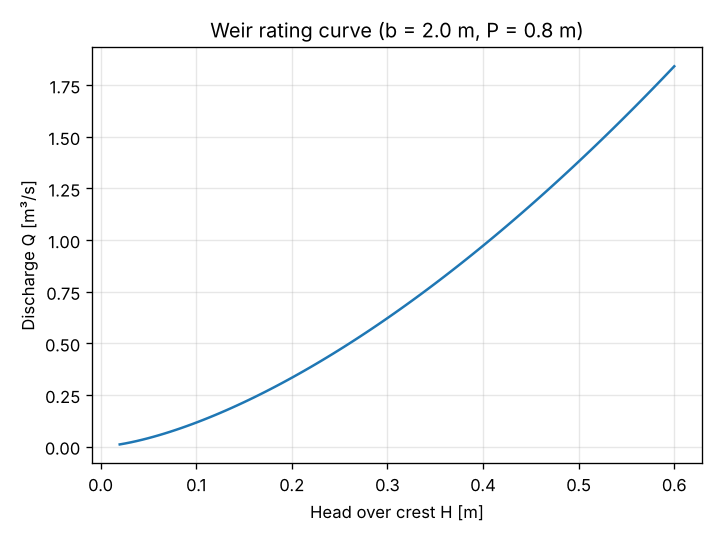

# Open-Channel Hydraulics Toolkit 🌊

  

A small, tested Python toolkit for everyday **open-channel hydraulics** calculations:
uniform flow in canals, critical flow, measuring weirs and hydraulic jumps in stilling basins.

I built it to turn the hand calculations from my hydraulic engineering studies at TUM
(and lab work at the Obernach research station) into reusable, verified code.

## Features

| Module | What it calculates |
|---|---|
| `Channel` (rectangular / trapezoidal / triangular) | Area, wetted perimeter, hydraulic radius, **Manning discharge**, **normal depth**, **critical depth**, Froude number, specific energy, flow regime, mild/steep slope |
| Sharp-crested weir | Discharge (Poleni equation, Rehbock coefficient) and required head for a given flow |
| Hydraulic jump | Sequent depth (Bélanger equation), energy loss, efficiency, approximate jump length, jump type (USBR classification) |

All root-finding (normal depth, critical depth, weir head) uses a robust bisection solver, so only `numpy` and `matplotlib` are needed.

## Quick start

Requires **Python 3.10 or newer**.

```bash
git clone https://github.com/aryaa-ji/open-channel-hydraulics.git
cd open-channel-hydraulics
pip install -r requirements.txt
python examples/demo.py      # runs the worked example and saves figures
pytest                       # runs the test suite
```

## Project structure

```
open-channel-hydraulics/
├── hydraulics/
│   ├── open_channel.py   # Channel class: geometry, Manning, normal & critical depth
│   └── structures.py     # sharp-crested weir and hydraulic jump
├── examples/demo.py      # worked example, prints results and saves figures
├── tests/                # automated tests (pytest)
├── figures/              # plots generated by the demo
└── .github/workflows/    # runs the tests automatically on every push
```

```python
from hydraulics import Channel, hydraulic_jump

canal = Channel(b=3.0, m=1.5, n=0.025, S=0.0005)   # trapezoidal canal
print(canal.summary(Q=10.0))
# normal depth 1.83 m, critical depth 0.89 m, Fr = 0.27 -> subcritical, mild slope

print(hydraulic_jump(y1=0.25, q=2.0))
# y2 = 1.69 m, Fr1 = 5.1 -> steady jump, ~50 % of the energy dissipated
```

## Worked example output

**1. Trapezoidal canal** (b = 3 m, side slope 1.5:1, n = 0.025, S = 0.0005, Q = 10 m³/s)

| Normal depth | Critical depth | Velocity | Froude | Regime |
|---|---|---|---|---|
| 1.83 m | 0.89 m | 0.95 m/s | 0.27 | subcritical (mild slope) |

**2. Measuring weir** (b = 2 m, P = 0.8 m): Q = 0.5 m³/s requires a head of 0.26 m.

**3. Stilling basin** (q = 2 m²/s, y₁ = 0.25 m): sequent depth 1.69 m, Fr₁ = 5.1 (steady jump), energy loss 1.76 m.

| Specific-energy diagram | Hydraulic jump characteristics |
|---|---|
|  |  |

| Canal rating curve | Weir rating curve |
|---|---|
|  |  |

## Equations used

- **Manning:** Q = (1/n) · A · R^(2/3) · S^(1/2)
- **Critical flow:** Q² · T / (g · A³) = 1
- **Froude number:** Fr = V / √(g · D), with D = A / T
- **Specific energy:** E = y + V² / 2g
- **Sharp-crested weir (Poleni):** Q = (2/3) · Cd · b · √(2g) · H^(3/2), Rehbock: Cd = 0.611 + 0.08 · H/P
- **Hydraulic jump (Bélanger):** y₂/y₁ = ½ (√(1 + 8 Fr₁²) − 1), ΔE = (y₂ − y₁)³ / (4 y₁ y₂)

## Tests

The test suite checks the code against closed-form solutions and physical principles,
for example the rectangular critical depth yc = (q²/g)^(1/3), the triangular critical depth,
Fr = 1 at critical depth and **conservation of momentum** across the hydraulic jump.
It also checks that invalid inputs (negative widths, zero flow) are rejected.

```
pytest
14 passed
```

The tests also run automatically on GitHub (Python 3.10 and 3.12) every time code is pushed.

## Limitations

- Prismatic channels with steady, uniform flow; no gradually varied flow profiles (yet).
- Hydraulic-jump relations assume a horizontal, rectangular channel.
- Jump length uses the rough estimate L ≈ 6·y₂; use design charts (e.g. USBR stilling basins) for real projects.
- The Rehbock weir coefficient is valid for a fully ventilated weir, roughly H/P < 1 and H > 0.03 m.
- This is a learning and portfolio project, not certified design software.

## Possible extensions

- Gradually varied flow (standard step method) for backwater curves
- Circular pipes / culverts
- Broad-crested weirs and spillway rating curves
- Sediment transport (Shields criterion, Meyer-Peter & Müller)

## Author

**Arya Aji**, M.Sc. Civil Engineering student, Technical University of Munich
[LinkedIn](https://linkedin.com/in/arya-aji-8ba163243) · [Portfolio](https://aryaa-ji.github.io)

## License

MIT, see [LICENSE](LICENSE).
